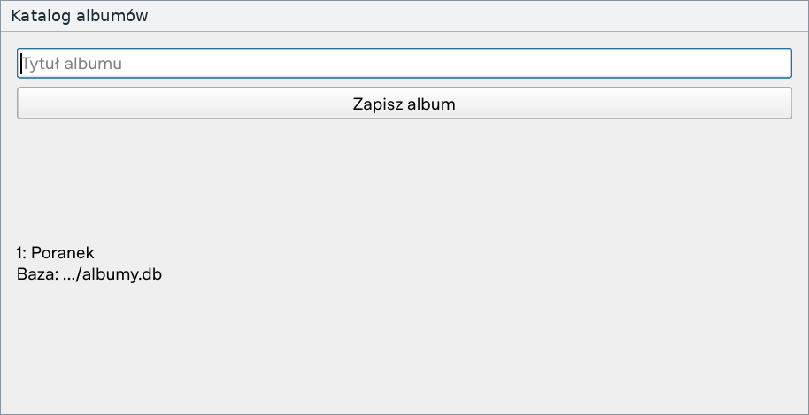
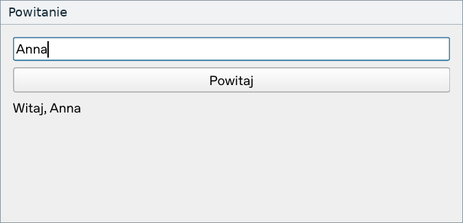
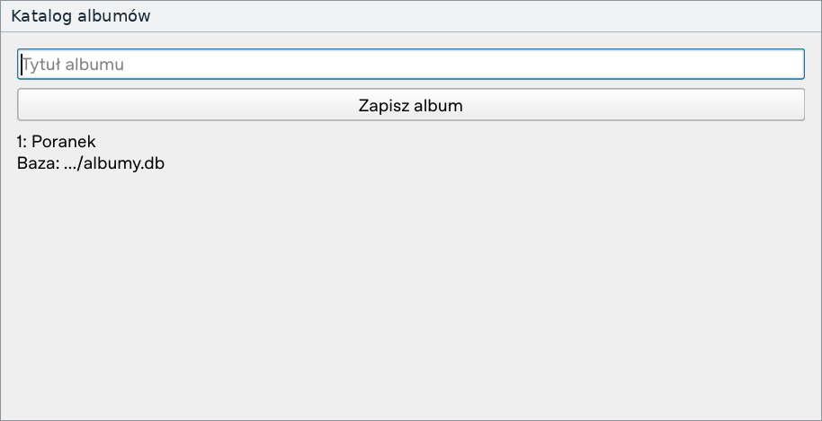
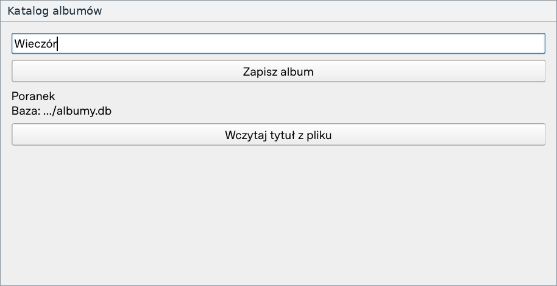

# Ćwiczenia: Przygotowanie programu do uruchomienia na innych komputerach: tworzenie pliku wykonywalnego (.exe)

**Temat 52 | Lekcje 103-104**

## Przygotowanie

Środowisko i polecenia uruchamiania opisano w [instrukcji głównej](../README.md#uruchamianie). Przed pracą zainstaluj zależności z dołączonego `requirements.txt` w wybranym środowisku: `py -m pip install -r requirements.txt`.

Utwórz pliki wskazane w zadaniach wewnątrz bieżącego folderu lekcji. Kod uruchamiaj w terminalu z tego folderu. Każde zadanie ma osobny starter. Zadania rozwijające aplikację wykonuj na kopii poprzedniego etapu, zgodnie z instrukcją startera.

## Projekt wejściowy i polecenia

**Pliki wejściowe.** W `startery/` masz gotowe przykłady do pakowania w zadaniach 1 i 2. W zadaniach 2–4 skopiuj odpowiedni `okno_zadanieN.ui` obok skryptu jako `okno.ui`. Przy pracy nad kolejnym zadaniem użyj osobnego folderu. W 3 i 4 uzupełniasz obsługę danych.

Przed budowaniem uruchom plik danego zadania w środowisku z PyQt6 i PyInstallerem. Pierwszy przykład tworzy proste okno w kodzie. W zadaniach 2–4 aplikacja odczytuje formularz `okno.ui`. W zadaniach 3 i 4 baza trafia do katalogu danych użytkownika.

```powershell
python -m PyInstaller --onedir zadanie1.py
python -m PyInstaller --onedir --add-data "okno.ui:." zadanie2.py
python -m PyInstaller --onefile --add-data "okno.ui:." zadanie3.py
```

Dla onedir przekaż cały katalog wynikowy, np. `dist/zadanie1`. Dla onefile na Windows plikiem wynikowym jest `dist/zadanie3.exe`.

## Sposób pracy podczas bloku

| Etap | Czas | Co robisz |
| --- | ---: | --- |
| Wyjaśnienia i demonstracja | 0-25 min | Czytasz przykład, przewidujesz wynik i zadajesz pytania. |
| Zadanie 1 z prowadzącym | 25-35 min | Uruchamiasz pierwszy wariant i objaśniasz kluczowy zapis. |
| Zadanie 2 wspólnie | 35-50 min | Proponujesz kolejne kroki, sam zapisujesz kod. |
| Zadanie 3 samodzielnie | 50-70 min | Realizujesz kontrakt i wykonujesz próby. |
| Zadanie 4 lub diagnoza błędu | 70-85 min | Sprawdzasz przypadki graniczne i poprawiasz program. |
| Zakończenie | 85-90 min | Zapisujesz kod, jeden wniosek i wykonane próby. |

Tempo ustala nauczyciel. Jeśli zadanie 4 jest większe, stanowi kontynuację na kolejnych zajęciach lub zastępuje dodatkową diagnozę. Zadania dodatkowe nie są warunkiem ukończenia podstawowego bloku.

**Podczas pracy:** korzystaj z [tabel składni i krótkich wzorców](KONSTRUKCJE.md). W [starterach](startery/README.md) znajdziesz punkty wyjścia. Pełne polecenia i nazwy docelowych plików są poniżej.

## Zadanie 1. Paczka onedir

**Punkt wyjścia:** [starter zadania 1](startery/zadanie1.py).

**Widok wzorcowy.** Okno „Katalog albumów” z polem tytułu, przyciskiem zapisu i miejscem na listę oraz ścieżkę bazy. W pierwszej próbie pakujemy prosty program, który buduje okno w Pythonie.



- Sprawdź działanie zadanie1.py, potem zbuduj --onedir z widoczną konsolą.
- Skopiuj cały dist/zadanie1 do nowego folderu testowego.
- Uruchom plik wynikowy z tego folderu. Zanotuj brakujące zasoby lub błędy.

**Wynik kontrolny:** aplikacja działa bez otwartego projektu źródłowego.

## Zadanie 2. Interfejs .ui

**Punkt wyjścia:** [starter zadania 2](startery/zadanie2.py).

**Widok wzorcowy.** Okno „Powitanie” z pola imienia, przycisku „Powitaj” i etykiety. Wzór interfejsu pochodzi z tematu 32.



Formularz wykorzystuje `imieEdit` (QLineEdit), `powitajButton` (QPushButton) i `wynikLabel` (QLabel).

- Spakuj formularz z tematu 32, używający loadUi.
- Dołącz okno.ui przez --add-data i odczytuj ścieżkę względem __file__.
- Sprawdź uruchomienie paczki z folderu o innej ścieżce.

**Wynik kontrolny:** formularz ładuje się bez kopiowania .ui ręcznie obok źródeł.

## Zadanie 3. Trwała baza

**Punkt wyjścia:** [starter zadania 3](startery/zadanie3.py).

**Widok wzorcowy.** Pole „Tytuł albumu”, „Zapisz album”, a pod nimi zapisane tytuły i informacja o ścieżce bazy. Graficzny układ jest w `okno.ui`.



Formularz wykorzystuje `tytulEdit` (QLineEdit), `zapiszButton` (QPushButton) i `wynikLabel` (QLabel).

- W projekcie albumów wczytaj dostarczony formularz `okno.ui` i umieść bazę w AppDataLocation. Dołącz `okno.ui` do paczki, jak w zadaniu 2.
- Dodaj rekord, zamknij program i uruchom go ponownie.
- Zbuduj onefile i powtórz test. Wypisz w URUCHOMIENIE.md faktyczne miejsce bazy.

**Wynik kontrolny:** rekord pozostaje po obu restartach.

## Zadanie 4. Dla chętnych: Przekazanie odbiorcy

**Punkt wyjścia:** [starter zadania 4](startery/zadanie4.py).

**Widok wzorcowy.** Widok zapisu albumu z dodatkowym przyciskiem „Wczytaj tytuł z pliku”. Dialog pozwala wybrać plik tekstowy.



Do kontrolek z zadania 3 dochodzi `importujButton` (QPushButton).

- Przygotuj paczkę onedir lub onefile z `okno.ui` dla tego samego systemu i architektury. Wypróbuj przycisk „Wczytaj tytuł z pliku”.
- Sprawdź start, zapis, odczyt, anulowanie dialogu i brak zasobu.
- Dodaj krótką instrukcję uruchomienia oraz wersje użytych zależności.

**Wynik kontrolny:** odbiorca wie, co uruchomić i gdzie program zapisuje dane.

## Diagnoza i praca domowa

Otwórz [zadanie naprawcze](diagnoza/README.md). Ma własny kontrakt i celowo błędny kod. Wykonaj je na zajęciach lub dokończ w domu zgodnie z ustaleniem prowadzącego.

## Oddanie pracy

Dołącz własny plik `.ui` do kodu zadania okienkowego, jeśli był używany.

Zachowaj źródła i niezbędne pliki danych. W `testy.md` opisz rzeczywiście wykonane próby: dane, oczekiwany wynik, wynik otrzymany i wniosek. Własną instrukcję uruchomienia zapisz w `URUCHOMIENIE.md`, aby zachować treść zadań w tym README. Dołącz dokumentację wskazaną w poleceniu. Zadania oznaczone jako dodatkowe są dla chętnych.

[Spis lekcji](../README.md)

## Utrwalanie Git w ramach tego bloku

Przed zmianą sprawdź `git status`, a po działającej poprawce obejrzyj `git diff`. Zapisz mały commit z opisem wykonanej zmiany. Czynność zajmuje 2–3 minuty przewidziane na sprawdzenie pracy.
