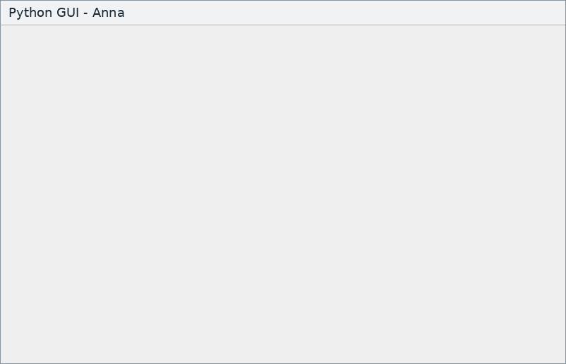
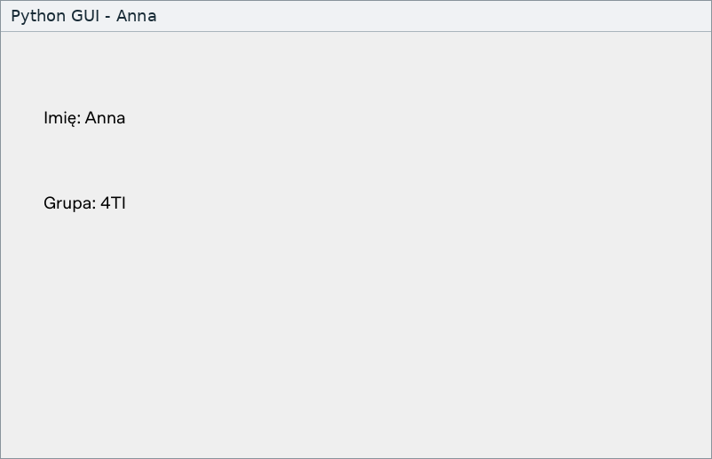
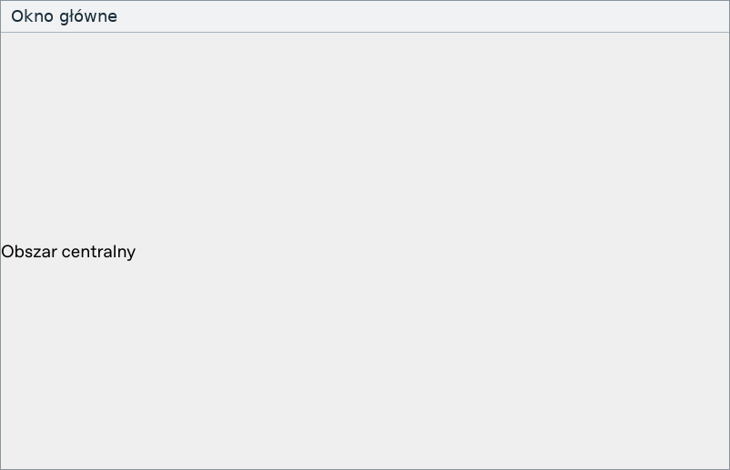

# Ćwiczenia: Tworzenie pierwszego okna aplikacji w PyQt: okno główne i uruchomienie programu

**Temat 31 | Lekcje 61-62**

## Przygotowanie

Ten blok pokazuje, jak Python tworzy pierwsze okno. Od tematu 32 wygląd projektujemy w Qt Designer.

Środowisko i polecenia uruchamiania opisano w [instrukcji głównej](../README.md#uruchamianie). Przed pracą zainstaluj zależności z dołączonego `requirements.txt` w wybranym środowisku: `py -m pip install -r requirements.txt`.

Utwórz pliki wskazane w zadaniach wewnątrz bieżącego folderu lekcji. Kod uruchamiaj w terminalu z tego folderu. Każde zadanie ma osobny starter. Zadania rozwijające aplikację wykonuj na kopii poprzedniego etapu, zgodnie z instrukcją startera.

## Organizacja programów

Zainstaluj PyQt6 według instrukcji na stronie głównej repozytorium. Dla zadania 1 utwórz `QApplication`, `QWidget`, ustaw tytuł i rozmiar, wywołaj show oraz app.exec. Zachowaj referencję do okna. Zadania zapisz jako `zadanie1.py` itd.; `main.py` może zawierać końcową wersję. Tylko jedna instancja QApplication w pojedynczym procesie. Te ćwiczenia wymagają środowiska graficznego.

## Sposób pracy podczas bloku

| Etap | Czas | Co robisz |
| --- | ---: | --- |
| Wyjaśnienia i demonstracja | 0-25 min | Czytasz przykład, przewidujesz wynik i zadajesz pytania. |
| Zadanie 1 z prowadzącym | 25-35 min | Uruchamiasz pierwszy wariant i objaśniasz kluczowy zapis. |
| Zadanie 2 wspólnie | 35-50 min | Proponujesz kolejne kroki, sam zapisujesz kod. |
| Zadanie 3 samodzielnie | 50-70 min | Realizujesz kontrakt i wykonujesz próby. |
| Zadanie 4 lub diagnoza błędu | 70-85 min | Sprawdzasz przypadki graniczne i poprawiasz program. |
| Zakończenie | 85-90 min | Zapisujesz kod, jeden wniosek i wykonane próby. |

Tempo ustala nauczyciel. Jeśli zadanie 4 jest większe, stanowi kontynuację na kolejnych zajęciach lub zastępuje dodatkową diagnozę. Zadania dodatkowe nie są warunkiem ukończenia podstawowego bloku.

**Podczas pracy:** korzystaj z [tabel składni i krótkich wzorców](KONSTRUKCJE.md). W [starterach](startery/README.md) znajdziesz punkty wyjścia. Pełne polecenia i nazwy docelowych plików są poniżej.

## Zadanie 1. Uruchom i zamknij

**Punkt wyjścia:** [starter zadania 1](startery/zadanie1.py).

**Widok wzorcowy.** Puste okno QWidget. Tytuł „Python GUI - Anna” (Anna to przykład). Rozmiar 500 × 300.

- Uzupełnij `zadanie1.py` i uruchom go w terminalu.
- Nadaj tytuł „Python GUI - imię” i rozmiar 500 na 300.
- Zamknij okno przyciskiem systemowym. Sprawdź powrót do terminalu.

**Wynik kontrolny:** widoczne okno, potem normalne zakończenie programu.

## Zadanie 2. Dwie etykiety

**Punkt wyjścia:** [starter zadania 2](startery/zadanie2.py).

**Widok wzorcowy.** Okno QWidget 500 × 300. Etykiety „Imię: Anna” i „Grupa: 4TI” pod sobą, w pozycjach z polecenia.

- Dodaj do QWidget dwa QLabel: „Imię: Anna” i „Grupa: 4TI”.
- Rozmieść je na (30,40) i (30,100), nadaj obszary 300 na 40.
- Zmień rozmiar okna i sprawdź, co dzieje się z pozycjami.

**Wynik kontrolny:** obie etykiety widoczne, ich pozycje pozostają stałe.

## Zadanie 3. Klasa okna

**Punkt wyjścia:** [starter zadania 3](startery/zadanie3.py).

**Widok wzorcowy.** Widok taki jak w zadaniu 2, a kontrolki należą do instancji klasy Okno.

- Przenieś budowę QWidget do klasy Okno i konstruktora __init__.
- Wywołaj konstruktor klasy bazowej i zachowaj QLabel w self.napis.
- W programie głównym utwórz QApplication, obiekt Okno i uruchom pętlę.

**Wynik kontrolny:** ten sam wygląd, jedno uruchomienie QApplication.

## Zadanie 4. Dla chętnych: Okno główne

**Punkt wyjścia:** [starter zadania 4](startery/zadanie4.py).

**Widok wzorcowy.** QMainWindow 500 × 300. W centralnej części etykieta „Obszar centralny”.

- Utwórz osobny program oparty na QMainWindow.
- Ustaw QLabel „Obszar centralny” przez setCentralWidget.
- Zwiększ rozmiar okna. Porównaj zachowanie z etykietą ustawioną przez move.

**Wynik kontrolny:** obszar centralny dopasowuje się do dostępnego miejsca.

## Diagnoza i praca domowa

Otwórz [zadanie naprawcze](diagnoza/README.md). Ma własny kontrakt i celowo błędny kod. Wykonaj je na zajęciach lub dokończ w domu zgodnie z ustaleniem prowadzącego.

## Oddanie pracy

Zachowaj źródła i niezbędne pliki danych. W `testy.md` opisz rzeczywiście wykonane próby: dane, oczekiwany wynik, wynik otrzymany i wniosek. Własną instrukcję uruchomienia zapisz w `URUCHOMIENIE.md`, aby zachować treść zadań w tym README. Dołącz dokumentację wskazaną w poleceniu. Zadania oznaczone jako dodatkowe są dla chętnych.

[Spis lekcji](../README.md)
