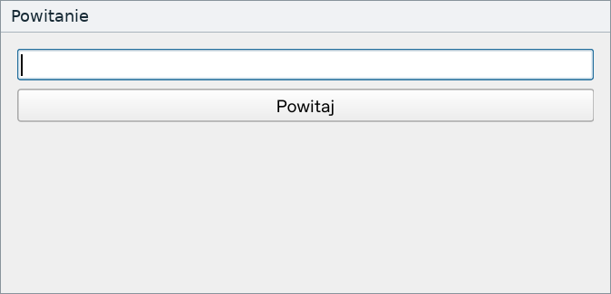
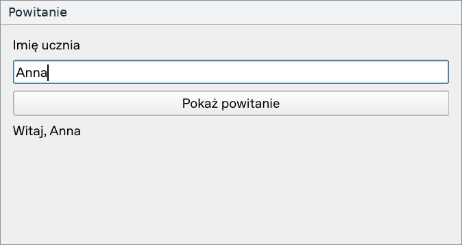
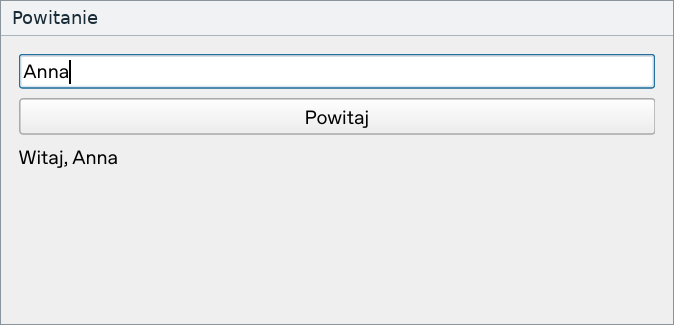

# Ćwiczenia: Wizualne projektowanie wyglądu okna w programie Qt Designer i łączenie go z kodem Pythona

**Temat 32 | Lekcje 63-64**

## Przygotowanie

Środowisko i polecenia uruchamiania opisano w [instrukcji głównej](../README.md#uruchamianie). Przed pracą zainstaluj zależności z dołączonego `requirements.txt` w wybranym środowisku: `py -m pip install -r requirements.txt`.

Utwórz pliki wskazane w zadaniach wewnątrz bieżącego folderu lekcji. Kod uruchamiaj w terminalu z tego folderu. Każde zadanie ma osobny starter. Zadania rozwijające aplikację wykonuj na kopii poprzedniego etapu, zgodnie z instrukcją startera.

## Specyfikacja formularza

W Qt Designer wybierz **Widget (QWidget)**, pozostaw nazwę głównego formularza `Form` i nadaj mu tytuł „Powitanie”. W oknie umieść od góry pole, przycisk oraz początkowo pustą etykietę. Ułóż kontrolki pionowo przy pomocy layoutu. W zadaniach 1–3 korzystasz z własnego projektu i odczytu pliku `uic.loadUi()`. Generowanie modułu `.py` poznasz w zadaniu dodatkowym.

## Sposób pracy podczas bloku

| Etap | Czas | Co robisz |
| --- | ---: | --- |
| Wyjaśnienia i demonstracja | 0-25 min | Czytasz przykład, przewidujesz wynik i zadajesz pytania. |
| Zadanie 1 z prowadzącym | 25-35 min | Uruchamiasz pierwszy wariant i objaśniasz kluczowy zapis. |
| Zadanie 2 wspólnie | 35-50 min | Proponujesz kolejne kroki, sam zapisujesz kod. |
| Zadanie 3 samodzielnie | 50-70 min | Realizujesz kontrakt i wykonujesz próby. |
| Zadanie 4 lub diagnoza błędu | 70-85 min | Sprawdzasz przypadki graniczne i poprawiasz program. |
| Zakończenie | 85-90 min | Zapisujesz kod, jeden wniosek i wykonane próby. |

Tempo ustala nauczyciel. Jeśli zadanie 4 jest większe, stanowi kontynuację na kolejnych zajęciach lub zastępuje dodatkową diagnozę. Zadania dodatkowe nie są warunkiem ukończenia podstawowego bloku.

**Podczas pracy:** korzystaj z [tabel składni i krótkich wzorców](KONSTRUKCJE.md). W [starterach](startery/README.md) znajdziesz punkty wyjścia. Pełne polecenia i nazwy docelowych plików są poniżej.

## Zadanie 1. Projekt formularza

**Punkt wyjścia:** [starter zadania 1](startery/zadanie1/README.md).

**Widok wzorcowy.** Układ pionowy. Od góry pole imienia, przycisk „Powitaj” i początkowo pusta etykieta wyniku. Zrzut może pokazywać przykładowe dane po wykonaniu próby.

**Plik projektu** `okno.ui`, typ `QWidget`, tytuł „Powitanie”.

| Kontrolka | `objectName` |
| --- | --- |
| QLineEdit | `imieEdit` |
| QPushButton | `powitajButton` |
| QLabel | `wynikLabel` |

- Odtwórz widok w Qt Designer. Ustaw wskazane nazwy i układ.
- Zapisz `okno.ui`. W Designerze sprawdź puste pole, napis na przycisku i zachowanie układu przy zmianie rozmiaru.

**Wynik kontrolny:** Trzy kontrolki w layoutcie, poprawne `objectName`.

## Zadanie 2. Wczytanie i akcja

**Punkt wyjścia:** [starter zadania 2](startery/zadanie2/README.md).

**Widok wzorcowy.** Układ pionowy. Od góry pole imienia, przycisk „Powitaj” i początkowo pusta etykieta wyniku. Zrzut może pokazywać przykładowe dane po wykonaniu próby.

**Plik projektu** `okno.ui`, typ `QWidget`, tytuł „Powitanie”.

| Kontrolka | `objectName` |
| --- | --- |
| QLineEdit | `imieEdit` |
| QPushButton | `powitajButton` |
| QLabel | `wynikLabel` |

- Skopiuj `okno.ui` z zadania 1 obok `zadanie2.py` i wczytaj go przez `uic.loadUi()`.
- Połącz kliknięcie z powitaniem. Dla pustego imienia lub samych spacji pokaż „Podaj imię”.
- Dla „ Anna ” pokaż „Witaj, Anna”.

**Wynik kontrolny:** Po kliknięciu działa powitanie i obsługa pustego pola.

## Zadanie 3. Zmiana wyglądu w Designerze

**Punkt wyjścia:** [starter zadania 3](startery/zadanie3/README.md).

**Widok wzorcowy.** Układ z poprzedniego zadania. Nad polem podpis „Imię ucznia”, na przycisku „Pokaż powitanie”. Zrzut może pokazywać przykładowe dane po wykonaniu próby.

**Plik projektu** `okno_zadanie3.ui`, typ `QWidget`, tytuł „Powitanie”.

| Kontrolka | `objectName` |
| --- | --- |
| QLineEdit | `imieEdit` |
| QPushButton | `powitajButton` |
| QLabel | `wynikLabel` |

- Otwórz formularz z poprzedniego zadania i zapisz kopię jako `okno_zadanie3.ui`.
- Nad polem dodaj „Imię ucznia”, a tekst przycisku zmień na „Pokaż powitanie”. Zachowaj `objectName` używane przez skrypt.
- Uruchom `zadanie3.py` i powtórz próby z zadania 2. Pozostaw w Pythonie tę samą obsługę przycisku.

**Wynik kontrolny:** Nowy wygląd pojawia się przy ponownym uruchomieniu. Powitanie działa jak wcześniej.

## Zadanie 4. Dla chętnych: Wariant generowany

**Punkt wyjścia:** [starter zadania 4](startery/zadanie4/README.md).

**Widok wzorcowy.** Układ pionowy. Od góry pole imienia, przycisk „Powitaj” i początkowo pusta etykieta wyniku. Zrzut może pokazywać przykładowe dane po wykonaniu próby.

**Plik projektu** `okno.ui`, typ `QWidget`, tytuł „Powitanie”.

| Kontrolka | `objectName` |
| --- | --- |
| QLineEdit | `imieEdit` |
| QPushButton | `powitajButton` |
| QLabel | `wynikLabel` |

- W osobnym folderze skopiuj podstawowy `okno.ui` z zadania 1. Uruchom `python -m PyQt6.uic.pyuic okno.ui -o ui_okno.py`.
- Zaimportuj `Ui_Form`, wywołaj `setupUi(self)` i połącz sygnał w swojej klasie w `zadanie4.py`.
- Zmień np. tekst przycisku w Designerze, wygeneruj moduł ponownie i sprawdź, kiedy widać zmianę.

**Wynik kontrolny:** Własna obsługa pozostaje w `zadanie4.py`, a generator zastępuje wyłącznie `ui_okno.py`.

## Diagnoza i praca domowa

Otwórz [zadanie naprawcze](diagnoza/README.md). Ma własny kontrakt i celowo błędny kod. Wykonaj je na zajęciach lub dokończ w domu zgodnie z ustaleniem prowadzącego.

## Oddanie pracy

Dołącz własny plik `.ui` do kodu zadania okienkowego, jeśli był używany.

Zachowaj źródła i niezbędne pliki danych. W `testy.md` opisz rzeczywiście wykonane próby: dane, oczekiwany wynik, wynik otrzymany i wniosek. Własną instrukcję uruchomienia zapisz w `URUCHOMIENIE.md`, aby zachować treść zadań w tym README. Dołącz dokumentację wskazaną w poleceniu. Zadania oznaczone jako dodatkowe są dla chętnych.

[Spis lekcji](../README.md)
