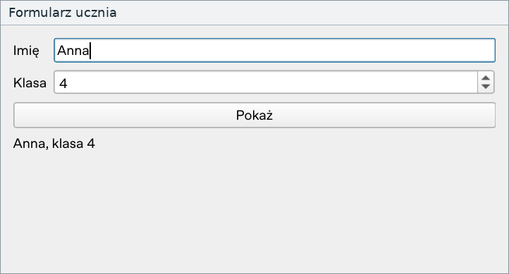
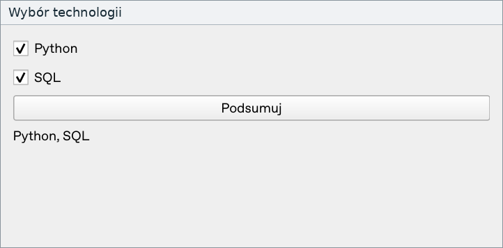
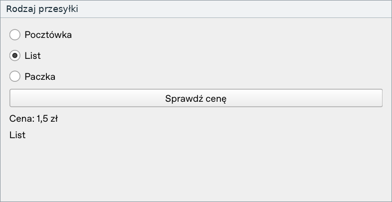
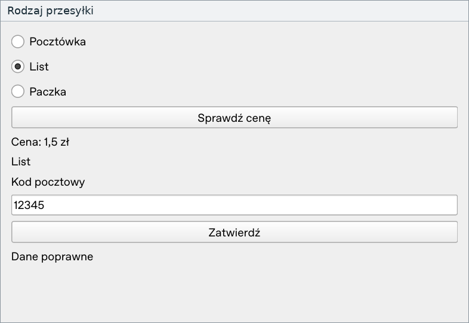

# Ćwiczenia: Dodawanie i obsługa elementów okna: napisy, pola tekstowe, przyciski i opcje wyboru

**Temat 33 | Lekcje 65-66**

## Przygotowanie

W Qt Designer wybierz typ okna podany w zadaniu, ustaw `windowTitle` i odtwórz kontrolki z podglądu. Ustaw ich `objectName` według tabeli, zastosuj układ kontrolek i sprawdź podgląd przy zmianie rozmiaru. Zapisz plik `.ui` obok skryptu, zgodnie z nazwą z polecenia. W Pythonie odczytaj formularz przez `uic.loadUi()`, a potem podłącz sygnały i dopisz działanie. Podgląd pokazuje przykład. Kolory systemowe, font i dokładna wielkość okna mogą się różnić.

Środowisko i polecenia uruchamiania opisano w [instrukcji głównej](../README.md#uruchamianie). Przed pracą zainstaluj zależności z dołączonego `requirements.txt` w wybranym środowisku: `py -m pip install -r requirements.txt`.

Utwórz pliki wskazane w zadaniach wewnątrz bieżącego folderu lekcji. Kod uruchamiaj w terminalu z tego folderu. Każde zadanie ma osobny starter. Zadania rozwijające aplikację wykonuj na kopii poprzedniego etapu, zgodnie z instrukcją startera.

## Ustalenia formularza

Kod zapisuj w `main.py` albo w osobnych plikach kolejnych zadań. Wyniki pokaż jako tekst, np. przez QLabel.setText; nie interpretuj tekstu użytkownika jako HTML. Cennik do zadania 3: Pocztówka = 1 zł, List = 1,5 zł, Paczka = 10 zł. Początkowo wybrana jest Pocztówka, ale cena pojawia się po kliknięciu. W zadaniu 4 najpierw sprawdzaj długość kodu, potem każdy znak jako cyfrę ASCII 0-9; wynik wyświetlaj po kliknięciu „Zatwierdź”.

## Sposób pracy podczas bloku

| Etap | Czas | Co robisz |
| --- | ---: | --- |
| Wyjaśnienia i demonstracja | 0-25 min | Czytasz przykład, przewidujesz wynik i zadajesz pytania. |
| Zadanie 1 z prowadzącym | 25-35 min | Uruchamiasz pierwszy wariant i objaśniasz kluczowy zapis. |
| Zadanie 2 wspólnie | 35-50 min | Proponujesz kolejne kroki, sam zapisujesz kod. |
| Zadanie 3 samodzielnie | 50-70 min | Realizujesz kontrakt i wykonujesz próby. |
| Zadanie 4 lub diagnoza błędu | 70-85 min | Sprawdzasz przypadki graniczne i poprawiasz program. |
| Zakończenie | 85-90 min | Zapisujesz kod, jeden wniosek i wykonane próby. |

Tempo ustala nauczyciel. Jeśli zadanie 4 jest większe, stanowi kontynuację na kolejnych zajęciach lub zastępuje dodatkową diagnozę. Zadania dodatkowe nie są warunkiem ukończenia podstawowego bloku.

**Podczas pracy:** korzystaj z [tabel składni i krótkich wzorców](KONSTRUKCJE.md). W [starterach](startery/README.md) znajdziesz punkty wyjścia. Pełne polecenia i nazwy docelowych plików są poniżej.

## Zadanie 1. Formularz ucznia

**Punkt wyjścia:** [starter zadania 1](startery/zadanie1.py).

**Widok wzorcowy.** U góry wiersze „Imię” i „Klasa” z polami. Pole klasy przyjmuje 1–5 i startuje od 1. Poniżej „Pokaż” oraz miejsce na wynik. Zrzut może pokazywać przykładowe dane po wykonaniu próby.

**Plik projektu** `zadanie1.ui`, typ `QWidget`, tytuł „Formularz ucznia”.

| Kontrolka | `objectName` |
| --- | --- |
| QLineEdit | `imie` |
| QSpinBox | `klasa` |
| QPushButton | `pokazButton` |
| QLabel | `wynik` |

- Zbuduj QLineEdit „Imię”, QSpinBox 1-5 „Klasa” i przycisk „Pokaż”.
- Po kliknięciu wypisz w QLabel: „Anna, klasa 4” dla danych Anna i 4.
- Puste imię po strip ma dawać „Podaj imię”.

**Wynik kontrolny:** poprawne podsumowanie albo komunikat pustego pola.

## Zadanie 2. Opcje niezależne

**Punkt wyjścia:** [starter zadania 2](startery/zadanie2.py).

**Widok wzorcowy.** Pionowo pola wyboru „Python” i „SQL”, oba początkowo niezaznaczone. Pod nimi „Podsumuj” i etykieta wyniku. Zrzut może pokazywać przykładowe dane po wykonaniu próby.

**Plik projektu** `zadanie2.ui`, typ `QWidget`, tytuł „Wybór technologii”.

| Kontrolka | `objectName` |
| --- | --- |
| QCheckBox | `python` |
| QCheckBox | `sql` |
| QPushButton | `pokazButton` |
| QLabel | `wynik` |

- Dodaj QCheckBox „Python” i „SQL” oraz przycisk podsumowania.
- Wypisz wybrane nazwy w tej kolejności, rozdzielone przecinkiem.
- Gdy żadna nie jest wybrana, pokaż „Brak wyboru”.

**Wynik kontrolny:** „Python”, „SQL”, „Python, SQL” albo „Brak wyboru”.

## Zadanie 3. Rodzaj przesyłki i cena

**Punkt wyjścia:** [starter zadania 3](startery/zadanie3.py).

**Widok wzorcowy.** Od góry trzy przyciski radiowe, z zaznaczoną pocztówką. Niżej „Sprawdź cenę”, etykieta „Cena:” i miejsce na nazwę rodzaju. Zrzut może pokazywać przykładowe dane po wykonaniu próby.

**Plik projektu** `zadanie3.ui`, typ `QWidget`, tytuł „Rodzaj przesyłki”.

| Kontrolka | `objectName` |
| --- | --- |
| QRadioButton | `pocztowkaRadio` |
| QRadioButton | `listRadio` |
| QRadioButton | `paczkaRadio` |
| QPushButton | `cenaButton` |
| QLabel | `cena` |
| QLabel | `rodzaj` |

- Utwórz trzy pola radio i QButtonGroup. Pocztówka wybrana na początku.
- Dodaj przycisk „Sprawdź cenę” i QLabel z początkowym tekstem „Cena:”.
- Wyświetl cenę z powyższego cennika. Obraz zastąp etykietą rodzaju przesyłki. Adaptacja INF.04-01-23.06-SG, II: etykieta zamiast obrazu.

**Wynik kontrolny:** List: 1,5 zł. Paczka: 10 zł.

## Zadanie 4. Dla chętnych: Kod i zatwierdzenie

**Punkt wyjścia:** [starter zadania 4](startery/zadanie4.py).

**Widok wzorcowy.** Od góry trzy przyciski radiowe, z zaznaczoną pocztówką. Niżej „Sprawdź cenę”, etykieta „Cena:” i miejsce na nazwę rodzaju. Na dole pole kodu pocztowego, „Zatwierdź” i etykieta komunikatu. Zrzut może pokazywać przykładowe dane po wykonaniu próby.

**Plik projektu** `zadanie4.ui`, typ `QWidget`, tytuł „Rodzaj przesyłki”.

| Kontrolka | `objectName` |
| --- | --- |
| QRadioButton | `pocztowkaRadio` |
| QRadioButton | `listRadio` |
| QRadioButton | `paczkaRadio` |
| QPushButton | `cenaButton` |
| QLabel | `cena` |
| QLabel | `rodzaj` |
| QLineEdit | `kod` |
| QPushButton | `zatwierdzButton` |
| QLabel | `wynik` |

- Do zadania 3 dodaj QLineEdit kodu oraz przycisk „Zatwierdź”.
- Za krótki lub długi kod: „Wymagane 5 znaków”. Obcy znak: „Wymagane cyfry”.
- Poprawny kod: „Dane poprawne”. Sprawdź 12345, 1234, 12a45 i 12-345. Adaptacja INF.04-01-23.06-SG, II: uproszczone komunikaty.

**Wynik kontrolny:** tylko 12345 daje potwierdzenie.

## Diagnoza i praca domowa

Otwórz [zadanie naprawcze](diagnoza/README.md). Ma własny kontrakt i celowo błędny kod. Wykonaj je na zajęciach lub dokończ w domu zgodnie z ustaleniem prowadzącego.

## Oddanie pracy

Dołącz własny plik `.ui` do kodu zadania okienkowego, jeśli był używany.

Zachowaj źródła i niezbędne pliki danych. W `testy.md` opisz rzeczywiście wykonane próby: dane, oczekiwany wynik, wynik otrzymany i wniosek. Własną instrukcję uruchomienia zapisz w `URUCHOMIENIE.md`, aby zachować treść zadań w tym README. Dołącz dokumentację wskazaną w poleceniu. Zadania oznaczone jako dodatkowe są dla chętnych.

[Spis lekcji](../README.md)
