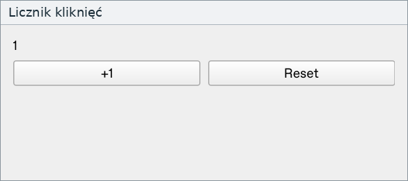
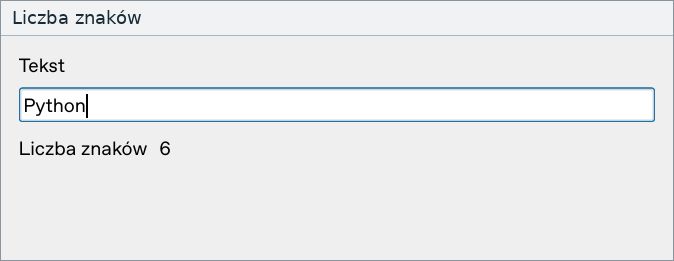
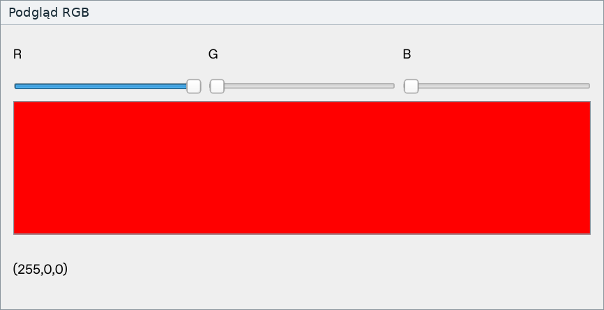
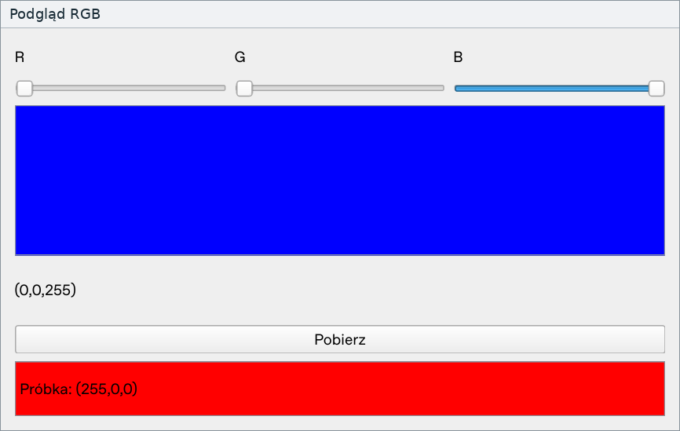

# Ćwiczenia: Łączenie przycisków z akcjami w kodzie: reagowanie na kliknięcia i wprowadzany tekst (sygnały i sloty)

**Temat 34 | Lekcje 67-68**

## Przygotowanie

W Qt Designer wybierz typ okna podany w zadaniu, ustaw `windowTitle` i odtwórz kontrolki z podglądu. Ustaw ich `objectName` według tabeli, nałóż layout i sprawdź podgląd przy zmianie rozmiaru. Zapisz plik `.ui` obok skryptu, zgodnie z nazwą z polecenia. W Pythonie odczytaj formularz przez `uic.loadUi()`, a potem podłącz sygnały i dopisz działanie. Podgląd pokazuje przykład. Kolory systemowe, font i dokładna wielkość okna mogą się różnić.

Środowisko i polecenia uruchamiania opisano w [instrukcji głównej](../README.md#uruchamianie). Przed pracą zainstaluj zależności z dołączonego `requirements.txt` w wybranym środowisku: `py -m pip install -r requirements.txt`.

Utwórz pliki wskazane w zadaniach wewnątrz bieżącego folderu lekcji. Kod uruchamiaj w terminalu z tego folderu. Każde zadanie ma osobny starter. Zadania rozwijające aplikację wykonuj na kopii poprzedniego etapu, zgodnie z instrukcją startera.

## Stan początkowy i zapis wersji

Każdy przykład zapisz osobno, np. `zadanie1.py`. Sygnały podłączaj raz podczas budowy okna. Zadania 3-4 tworzą kolejne wersje panelu RGB. Duży podgląd i zapisana próbka są odrębnymi kontrolkami oraz odrębnymi wartościami stanu. Na początku oba kolory są białe.

## Sposób pracy podczas bloku

| Etap | Czas | Co robisz |
| --- | ---: | --- |
| Wyjaśnienia i demonstracja | 0-25 min | Czytasz przykład, przewidujesz wynik i zadajesz pytania. |
| Zadanie 1 z prowadzącym | 25-35 min | Uruchamiasz pierwszy wariant i objaśniasz kluczowy zapis. |
| Zadanie 2 wspólnie | 35-50 min | Proponujesz kolejne kroki, sam zapisujesz kod. |
| Zadanie 3 samodzielnie | 50-70 min | Realizujesz kontrakt i wykonujesz próby. |
| Zadanie 4 lub diagnoza błędu | 70-85 min | Sprawdzasz przypadki graniczne i poprawiasz program. |
| Zakończenie | 85-90 min | Zapisujesz kod, jeden wniosek i wykonane próby. |

Tempo ustala nauczyciel. Jeśli zadanie 4 jest większe, stanowi kontynuację na kolejnych zajęciach lub zastępuje dodatkową diagnozę. Zadania dodatkowe nie są warunkiem ukończenia podstawowego bloku.

**Podczas pracy:** korzystaj z [tabel składni i krótkich wzorców](KONSTRUKCJE.md). W [starterach](startery/README.md) znajdziesz punkty wyjścia. Pełne polecenia i nazwy docelowych plików są poniżej.

## Zadanie 1. Licznik kliknięć

**Punkt wyjścia:** [starter zadania 1](startery/zadanie1.py).

**Widok wzorcowy.** Etykieta licznika z wartością 0 nad jednym wierszem przycisków „+1” i „Reset”. Zrzut może pokazywać przykładowe dane po wykonaniu próby.

**Plik projektu** `zadanie1.ui`, typ `QWidget`, tytuł „Licznik kliknięć”.

| Kontrolka | `objectName` |
| --- | --- |
| QLabel | `licznik_wynik` |
| QPushButton | `plusButton` |
| QPushButton | `resetButton` |

- Zbuduj etykietę wyniku, przyciski „+1” i „Reset”. Stan początkowy: 0.
- Pierwszy przycisk zwiększa pole self.licznik, drugi zeruje je.
- Kliknij +1 trzy razy, Reset i +1 jeden raz.

**Wynik kontrolny:** kolejno 1, 2, 3, 0, 1.

## Zadanie 2. Liczba znaków na żywo

**Punkt wyjścia:** [starter zadania 2](startery/zadanie2.py).

**Widok wzorcowy.** Pod podpisem „Tekst” jest puste pole tekstowe. W kolejnym wierszu podpis „Liczba znaków” i etykieta z 0. Zrzut może pokazywać przykładowe dane po wykonaniu próby.

**Plik projektu** `zadanie2.ui`, typ `QWidget`, tytuł „Liczba znaków”.

| Kontrolka | `objectName` |
| --- | --- |
| QLineEdit | `tekst` |
| QLabel | `dlugosc` |

- Połącz QLineEdit.textChanged z metodą pokazującą długość tekstu.
- Licz wszystkie znaki, także spacje. Pusty napis ma długość 0.
- Sprawdź „abc”, „a b” oraz wyczyszczenie pola.

**Wynik kontrolny:** 3, 3, 0.

## Zadanie 3. Podgląd RGB

**Punkt wyjścia:** [starter zadania 3](startery/zadanie3.py).

**Widok wzorcowy.** Trzy podpisane poziome suwaki R, G, B obok siebie. Każdy ma zakres 0–255 i wartość 255 na starcie. Niżej duży podgląd koloru i trzy wartości. Zrzut może pokazywać przykładowe dane po wykonaniu próby.

**Plik projektu** `zadanie3.ui`, typ `QWidget`, tytuł „Podgląd RGB”.

| Kontrolka | `objectName` |
| --- | --- |
| QSlider | `suwakR` |
| QSlider | `suwakG` |
| QSlider | `suwakB` |
| QLabel | `podglad` |
| QLabel | `wartosci` |

- Utwórz suwaki R, G, B 0-255, początkowo wszystkie ustawione na 255.
- Po każdej zmianie odśwież duży QLabel i napis z trzema wartościami.
- Sprawdź ustawienia (255,0,0), (0,255,0), (0,0,255). Adaptacja INF.04-01-25.06-SG, II: same suwaki i podgląd.

**Wynik kontrolny:** podgląd czerwony, zielony i niebieski.

## Zadanie 4. Dla chętnych: Zapamiętanie próbki

**Punkt wyjścia:** [starter zadania 4](startery/zadanie4.py).

**Widok wzorcowy.** Trzy podpisane poziome suwaki R, G, B obok siebie. Każdy ma zakres 0–255 i wartość 255 na starcie. Niżej duży podgląd koloru i trzy wartości. Pod nimi „Pobierz” i mniejsza próbka ostatniego zapisu. Zrzut może pokazywać przykładowe dane po wykonaniu próby.

**Plik projektu** `zadanie4.ui`, typ `QWidget`, tytuł „Podgląd RGB”.

| Kontrolka | `objectName` |
| --- | --- |
| QSlider | `suwakR` |
| QSlider | `suwakG` |
| QSlider | `suwakB` |
| QLabel | `podglad` |
| QLabel | `wartosci` |
| QPushButton | `pobierzButton` |
| QLabel | `probka` |

- Do zadania 3 dodaj „Pobierz” oraz osobny QLabel małej próbki i zapisanych wartości.
- Na początku próbka jest biała, (255,255,255). Zapisuj ją tylko przyciskiem.
- Pobierz czerwony, potem ustaw niebieski bez kliknięcia przycisku. Adaptacja INF.04-01-25.06-SG, II: własny układ okna.

**Wynik kontrolny:** duży podgląd niebieski, mała próbka nadal czerwona.

## Diagnoza i praca domowa

Otwórz [zadanie naprawcze](diagnoza/README.md). Ma własny kontrakt i celowo błędny kod. Wykonaj je na zajęciach lub dokończ w domu zgodnie z ustaleniem prowadzącego.

## Oddanie pracy

Dołącz własny plik `.ui` do kodu zadania okienkowego, jeśli był używany.

Zachowaj źródła i niezbędne pliki danych. W `testy.md` opisz rzeczywiście wykonane próby: dane, oczekiwany wynik, wynik otrzymany i wniosek. Własną instrukcję uruchomienia zapisz w `URUCHOMIENIE.md`, aby zachować treść zadań w tym README. Dołącz dokumentację wskazaną w poleceniu. Zadania oznaczone jako dodatkowe są dla chętnych.

[Spis lekcji](../README.md)
