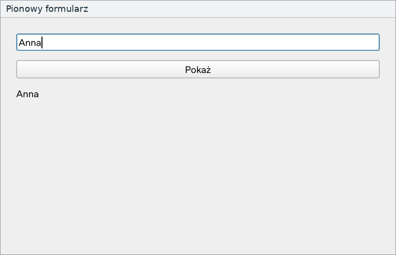
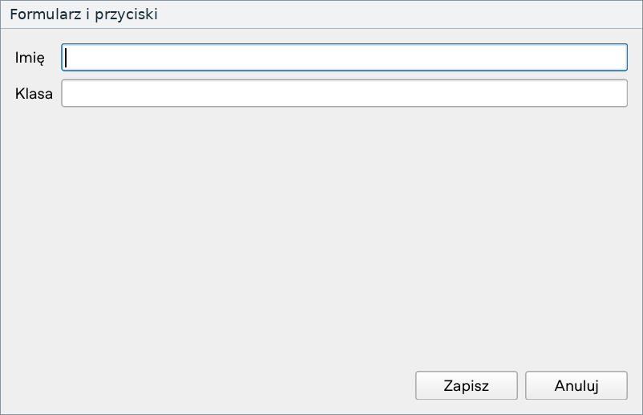
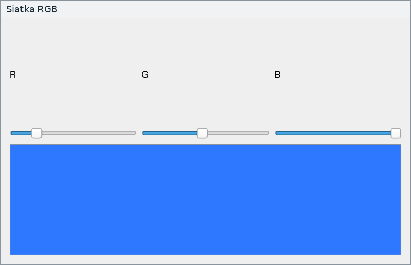
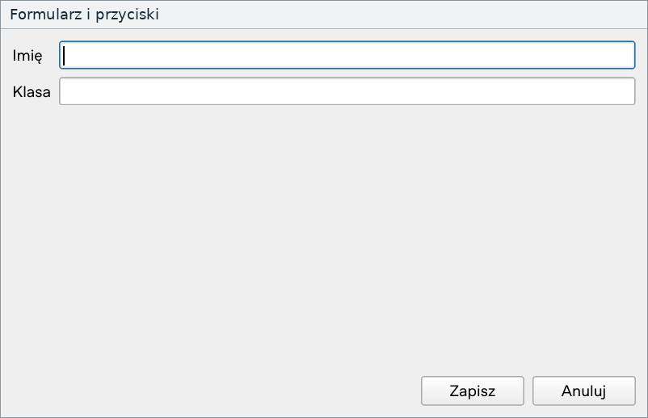
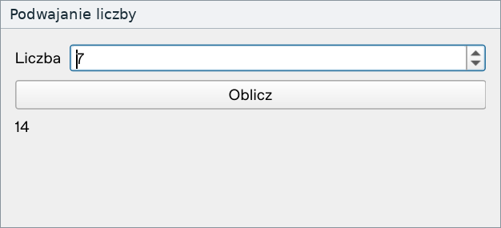

# Ćwiczenia: Układanie elementów w oknie: rozmieszczenie pionowe, poziome i dopasowanie do rozmiaru ekranu

**Temat 35 | Lekcje 69-70**

## Przygotowanie

W Qt Designer wybierz typ okna podany w zadaniu, ustaw `windowTitle` i odtwórz kontrolki z podglądu. Ustaw ich `objectName` według tabeli, nałóż layout i sprawdź podgląd przy zmianie rozmiaru. Zapisz plik `.ui` obok skryptu, zgodnie z nazwą z polecenia. W Pythonie odczytaj formularz przez `uic.loadUi()`, a potem podłącz sygnały i dopisz działanie. Podgląd pokazuje przykład. Kolory systemowe, font i dokładna wielkość okna mogą się różnić.

Środowisko i polecenia uruchamiania opisano w [instrukcji głównej](../README.md#uruchamianie). Przed pracą zainstaluj zależności z dołączonego `requirements.txt` w wybranym środowisku: `py -m pip install -r requirements.txt`.

Utwórz pliki wskazane w zadaniach wewnątrz bieżącego folderu lekcji. Kod uruchamiaj w terminalu z tego folderu. Każde zadanie ma osobny starter. Zadania rozwijające aplikację wykonuj na kopii poprzedniego etapu, zgodnie z instrukcją startera.

## Organizacja okna

Każde zadanie zapisz jako osobny program, zachowując wersje wcześniejsze. W zadaniu 1 przycisk „Pokaż” kopiuje przycięty tekst pola do etykiety; pusty tekst daje „Podaj imię”. Zadanie 2 ćwiczy rozmieszczenie i nie wymaga zapisu danych. W zadaniu 3 podpisy R, G, B i odpowiadające im suwaki mają tworzyć trzy kolumny; podgląd jest w kolejnym wierszu, z columnSpan=3. Zakres suwaków 0-255, zmiany odświeżają kolor.

## Sposób pracy podczas bloku

| Etap | Czas | Co robisz |
| --- | ---: | --- |
| Wyjaśnienia i demonstracja | 0-25 min | Czytasz przykład, przewidujesz wynik i zadajesz pytania. |
| Zadanie 1 z prowadzącym | 25-35 min | Uruchamiasz pierwszy wariant i objaśniasz kluczowy zapis. |
| Zadanie 2 wspólnie | 35-50 min | Proponujesz kolejne kroki, sam zapisujesz kod. |
| Zadanie 3 samodzielnie | 50-70 min | Realizujesz kontrakt i wykonujesz próby. |
| Połączenie formularza z funkcją | 70-80 min | Odczytujesz pole, wywołujesz funkcję i pokazujesz wynik. |
| Sprawdzenie połączenia | 80-85 min | Sprawdzasz wynik dla 0 i 7. |
| Zakończenie | 85-90 min | Zapisujesz kod, jeden wniosek i wykonane próby. |

Zadanie 4 i diagnoza są dla chętnych lub do samodzielnej kontynuacji. W podstawowym bloku zachowaj czas na połączenie formularza z funkcją. Tempo ustala nauczyciel.

**Podczas pracy:** korzystaj z [tabel składni i krótkich wzorców](KONSTRUKCJE.md). W [starterach](startery/README.md) znajdziesz punkty wyjścia. Pełne polecenia i nazwy docelowych plików są poniżej.

## Zadanie 1. Pionowy formularz

**Punkt wyjścia:** [starter zadania 1](startery/zadanie1.py).

**Widok wzorcowy.** Pionowo pole imienia, „Pokaż” i etykieta wyniku. Marginesy 20 px, odstępy 12 px. Sprawdź 500 × 300 i 800 × 450. Zrzut może pokazywać przykładowe dane po wykonaniu próby.

**Plik projektu** `zadanie1.ui`, typ `QWidget`, tytuł „Pionowy formularz”.

| Kontrolka | `objectName` |
| --- | --- |
| QLineEdit | `pole` |
| QPushButton | `pokaz` |
| QLabel | `wynik` |

- Utwórz QWidget, QLineEdit, QPushButton „Pokaż” i QLabel.
- Umieść je w QVBoxLayout, odstęp 12 i marginesy po 20.
- Ustaw rozmiar 500 na 300. Sprawdź także 800 na 450.

**Wynik kontrolny:** kolejność kontrolek zachowana, pola wykorzystują dostępne miejsce.

## Zadanie 2. Formularz i przyciski

**Punkt wyjścia:** [starter zadania 2](startery/zadanie2.py).

**Widok wzorcowy.** Dwa wiersze QFormLayout. Etykiety „Imię” i „Klasa” po lewej, pola po prawej. Na dole poziomy spacer i przyciski „Zapisz” oraz „Anuluj”. Zrzut może pokazywać przykładowe dane po wykonaniu próby.

**Plik projektu** `zadanie2.ui`, typ `QWidget`, tytuł „Formularz i przyciski”.

| Kontrolka | `objectName` |
| --- | --- |
| QLineEdit | `imie` |
| QLineEdit | `klasa` |
| QPushButton | `zapisz` |
| QPushButton | `anuluj` |

- Dodaj QFormLayout z polami Imię i Klasa oraz dolny QHBoxLayout.
- W dolnym układzie umieść stretch, „Zapisz” i „Anuluj”.
- Sprawdź widoczność etykiet przy wąskim i szerokim oknie.

**Wynik kontrolny:** etykiety w kolumnie, oba przyciski przy prawym brzegu.

## Zadanie 3. Siatka RGB

**Punkt wyjścia:** [starter zadania 3](startery/zadanie3.py).

**Widok wzorcowy.** W pierwszym wierszu QGridLayout trzy kolumny z podpisem i suwakiem. W drugim podgląd o wysokości co najmniej 120 px, rozpięty na wszystkie trzy kolumny. Zrzut może pokazywać przykładowe dane po wykonaniu próby.

**Plik projektu** `zadanie3.ui`, typ `QWidget`, tytuł „Siatka RGB”.

| Kontrolka | `objectName` |
| --- | --- |
| QSlider | `suwakR` |
| QSlider | `suwakG` |
| QSlider | `suwakB` |
| QLabel | `podglad` |

- Ułóż trzy podpisane suwaki RGB w jednym wierszu QGridLayout.
- Pod nimi umieść podgląd obejmujący wszystkie trzy kolumny.
- Nadaj podglądowi minimalną wysokość 120. Sprawdź zmianę rozmiaru.

**Wynik kontrolny:** trzy kolumny suwaków, szeroki podgląd pod nimi.

## Zadanie 4. Dla chętnych: QMainWindow bez nakładania

**Punkt wyjścia:** [starter zadania 4](startery/zadanie4.py).

**Widok wzorcowy.** Dwa wiersze QFormLayout. Etykiety „Imię” i „Klasa” po lewej, pola po prawej. Na dole poziomy spacer i przyciski „Zapisz” oraz „Anuluj”. Cały układ jest w centralwidget. Minimalny rozmiar to 400 × 250. Zrzut może pokazywać przykładowe dane po wykonaniu próby.

**Plik projektu** `zadanie4.ui`, typ `QMainWindow`, tytuł „Formularz i przyciski”.

| Kontrolka | `objectName` |
| --- | --- |
| QLineEdit | `imie` |
| QLineEdit | `klasa` |
| QPushButton | `zapisz` |
| QPushButton | `anuluj` |

- Przenieś układ zadania 2 do QMainWindow przez centralny QWidget.
- Ustal minimalny rozmiar 400 na 250. Sprawdź większy rozmiar.
- Usuń ręczne move i setGeometry dla kontrolek obsługiwanych przez układ.

**Wynik kontrolny:** kontrolki bez nakładania i bez wychodzenia poza obszar centralny.

## Diagnoza i praca domowa

Otwórz [zadanie naprawcze](diagnoza/README.md). Ma własny kontrakt i celowo błędny kod. Wykonaj je na zajęciach lub dokończ w domu zgodnie z ustaleniem prowadzącego.

## Oddanie pracy

Dołącz własny plik `.ui` do kodu zadania okienkowego, jeśli był używany.

Zachowaj źródła i niezbędne pliki danych. W `testy.md` opisz rzeczywiście wykonane próby: dane, oczekiwany wynik, wynik otrzymany i wniosek. Własną instrukcję uruchomienia zapisz w `URUCHOMIENIE.md`, aby zachować treść zadań w tym README. Dołącz dokumentację wskazaną w poleceniu. Zadania oznaczone jako dodatkowe są dla chętnych.

[Spis lekcji](../README.md)

## Połączenie logiki z oknem w ramach zadania 3

Ostatnie 8–10 minut zadania 3 przeznacz na spięcie znanych części. Funkcja `podwoj(liczba)` w osobnym module zwraca `liczba * 2`. Okno ma pole `QSpinBox`, przycisk oraz `QLabel`. Po kliknięciu odczytaj `value()`, wywołaj zaimportowaną funkcję i pokaż `str(wynik)` przez `setText()`. Sprawdź 0 i 7. Nie dodawaj nowego mechanizmu GUI. W razie wolniejszego tempa pomiń wariant dodatkowy.

W Qt Designer zapisz `integracja.ui` jako QWidget. W podglądzie widać stan po kliknięciu „Oblicz”. Ustaw `liczba` (QSpinBox 0–99), `obliczButton` (QPushButton) i `wynik` (QLabel) w układzie pionowym. Utwórz `integracja.py`, wczytaj formularz przez `uic.loadUi()` i zaimportuj funkcję `podwoj` z `logika.py`.

