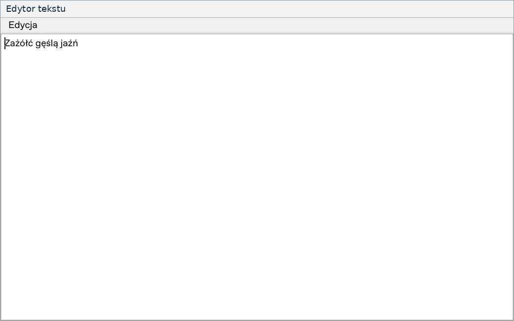
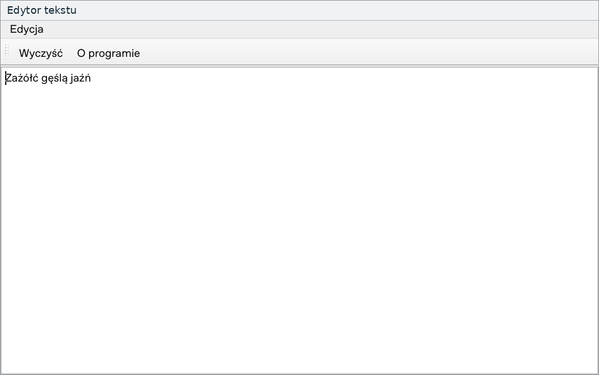
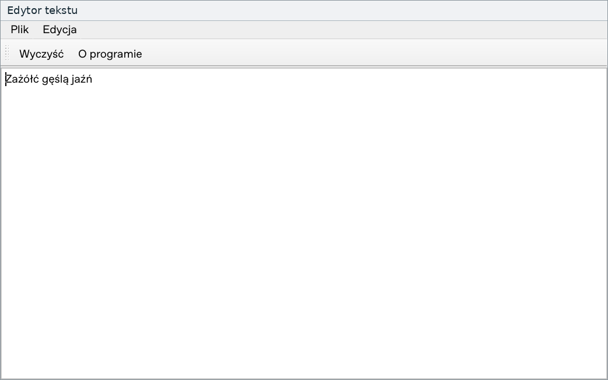

# Ćwiczenia: Tworzenie menu programu, paska narzędzi oraz okienek z komunikatami i wyborem pliku

**Temat 48 | Lekcje 95-96**

## Przygotowanie

W Qt Designer wybierz typ okna podany w zadaniu, ustaw `windowTitle` i odtwórz kontrolki z podglądu. Ustaw ich `objectName` według tabeli, nałóż layout i sprawdź podgląd przy zmianie rozmiaru. Zapisz plik `.ui` obok skryptu, zgodnie z nazwą z polecenia. W Pythonie odczytaj formularz przez `uic.loadUi()`, a potem podłącz sygnały i dopisz działanie. Podgląd pokazuje przykład. Kolory systemowe, font i dokładna wielkość okna mogą się różnić.

Środowisko i polecenia uruchamiania opisano w [instrukcji głównej](../README.md#uruchamianie). Przed pracą zainstaluj zależności z dołączonego `requirements.txt` w wybranym środowisku: `py -m pip install -r requirements.txt`.

Utwórz pliki wskazane w zadaniach wewnątrz bieżącego folderu lekcji. Kod uruchamiaj w terminalu z tego folderu. Każde zadanie ma osobny starter. Zadania rozwijające aplikację wykonuj na kopii poprzedniego etapu, zgodnie z instrukcją startera.

## Pliki projektu

Rozwijaj program etapami. Zapisz kolejne wersje jako `zadanie1.py`, `zadanie2.py`, `zadanie3.py` i `zadanie4.py`. QAction importuj z `PyQt6.QtGui`. Menu, pasek narzędzi i skrót mają korzystać z tej samej instancji akcji. Anulowanie dialogu rozpoznaj po pustej ścieżce, zanim otworzysz plik. Po nieudanym zapisie zachowaj tekst; po nieudanym odczycie nie zastępuj zawartości edytora.

## Sposób pracy podczas bloku

| Etap | Czas | Co robisz |
| --- | ---: | --- |
| Wyjaśnienia i demonstracja | 0-25 min | Czytasz przykład, przewidujesz wynik i zadajesz pytania. |
| Zadanie 1 z prowadzącym | 25-35 min | Uruchamiasz pierwszy wariant i objaśniasz kluczowy zapis. |
| Zadanie 2 wspólnie | 35-50 min | Proponujesz kolejne kroki, sam zapisujesz kod. |
| Zadanie 3 samodzielnie | 50-70 min | Realizujesz kontrakt i wykonujesz próby. |
| Zadanie 4 lub diagnoza błędu | 70-85 min | Sprawdzasz przypadki graniczne i poprawiasz program. |
| Zakończenie | 85-90 min | Zapisujesz kod, jeden wniosek i wykonane próby. |

Tempo ustala nauczyciel. Jeśli zadanie 4 jest większe, stanowi kontynuację na kolejnych zajęciach lub zastępuje dodatkową diagnozę. Zadania dodatkowe nie są warunkiem ukończenia podstawowego bloku.

**Podczas pracy:** korzystaj z [tabel składni i krótkich wzorców](KONSTRUKCJE.md). W [starterach](startery/README.md) znajdziesz punkty wyjścia. Pełne polecenia i nazwy docelowych plików są poniżej.

## Zadanie 1. Menu i skrót

**Punkt wyjścia:** [starter zadania 1](startery/zadanie1.py).

**Widok wzorcowy.** Na górze menu „Edycja” z akcją „Wyczyść” (Ctrl+L). Edytor tekstu wypełnia środek okna. Zrzut może pokazywać przykładowe dane po wykonaniu próby.

**Plik projektu** `zadanie1.ui`, typ `QMainWindow`, tytuł „Edytor tekstu”.

| Kontrolka | `objectName` |
| --- | --- |
| QTextEdit | `tekst` |
| QMenuBar | `menuBar` |
| QMenu | `menuEdycja` |
| QAction | `akcjaWyczysc` |

W Designerze utwórz akcje w Edytorze akcji. Tę samą akcję „Wyczyść” można dodać do menu i paska. Połączenia `triggered` zostają w Pythonie.

- Utwórz QMainWindow z QTextEdit w obszarze centralnym.
- Dodaj akcję „Wyczyść”, menu „Edycja” i skrót Ctrl+L.
- Obsługa ma wyczyścić tekst. Sprawdź zarówno menu, jak i skrót.

**Wynik kontrolny:** obie drogi wywołują tę samą akcję.

## Zadanie 2. Pasek narzędzi

**Punkt wyjścia:** [starter zadania 2](startery/zadanie2.py).

**Widok wzorcowy.** Na górze menu „Edycja” z akcją „Wyczyść” (Ctrl+L). Edytor tekstu wypełnia środek okna. Pod menu pasek z akcjami „Wyczyść” i „O programie”. Zrzut może pokazywać przykładowe dane po wykonaniu próby.

**Plik projektu** `zadanie2.ui`, typ `QMainWindow`, tytuł „Edytor tekstu”.

| Kontrolka | `objectName` |
| --- | --- |
| QTextEdit | `tekst` |
| QMenuBar | `menuBar` |
| QMenu | `menuEdycja` |
| QToolBar | `pasekNarzedzi` |
| QAction | `akcjaWyczysc` |
| QAction | `akcjaOProgramie` |

W Designerze utwórz akcje w Edytorze akcji. Tę samą akcję „Wyczyść” można dodać do menu i paska. Połączenia `triggered` zostają w Pythonie.

- Dodaj do zadania 1 QToolBar i tę samą akcję „Wyczyść”.
- Dodaj „O programie”, pokazującą information z tekstem „Edytor 1.0”.
- Sprawdź działanie po kilku użyciach. Nie twórz ponownych połączeń.

**Wynik kontrolny:** jedna akcja czyszczenia, czytelny dialog o programie.

## Zadanie 3. Zapis i anulowanie

**Punkt wyjścia:** [starter zadania 3](startery/zadanie3.py).

**Widok wzorcowy.** Na górze menu „Edycja” z akcją „Wyczyść” (Ctrl+L). Edytor tekstu wypełnia środek okna. Pod menu pasek z akcjami „Wyczyść” i „O programie”. W menu „Plik” jest „Zapisz” (Ctrl+S). Zrzut może pokazywać przykładowe dane po wykonaniu próby.

**Plik projektu** `zadanie3.ui`, typ `QMainWindow`, tytuł „Edytor tekstu”.

| Kontrolka | `objectName` |
| --- | --- |
| QTextEdit | `tekst` |
| QMenuBar | `menuBar` |
| QMenu | `menuPlik` |
| QMenu | `menuEdycja` |
| QToolBar | `pasekNarzedzi` |
| QAction | `akcjaWyczysc` |
| QAction | `akcjaOProgramie` |
| QAction | `akcjaZapisz` |

W Designerze utwórz akcje w Edytorze akcji. Tę samą akcję „Wyczyść” można dodać do menu i paska. Połączenia `triggered` zostają w Pythonie.

- Dodaj akcję „Zapisz” z Ctrl+S oraz dialog zapisu.
- Zapisz tekst „Zażółć gęślą jaźń” jako wynik.txt w UTF-8.
- Powtórz akcję i anuluj dialog. Obsłuż błąd zapisu przez warning.

**Wynik kontrolny:** tekst w pliku jest zgodny, anulowanie nie zmienia pliku.

## Zadanie 4. Dla chętnych: Otwieranie pliku

**Punkt wyjścia:** [starter zadania 4](startery/zadanie4.py).

**Widok wzorcowy.** Na górze menu „Edycja” z akcją „Wyczyść” (Ctrl+L). Edytor tekstu wypełnia środek okna. Pod menu pasek z akcjami „Wyczyść” i „O programie”. W menu „Plik” jest „Zapisz” (Ctrl+S). Druga akcja to „Otwórz” (Ctrl+O). Zrzut może pokazywać przykładowe dane po wykonaniu próby.

**Plik projektu** `zadanie4.ui`, typ `QMainWindow`, tytuł „Edytor tekstu”.

| Kontrolka | `objectName` |
| --- | --- |
| QTextEdit | `tekst` |
| QMenuBar | `menuBar` |
| QMenu | `menuPlik` |
| QMenu | `menuEdycja` |
| QToolBar | `pasekNarzedzi` |
| QAction | `akcjaWyczysc` |
| QAction | `akcjaOProgramie` |
| QAction | `akcjaZapisz` |
| QAction | `akcjaOtworz` |

W Designerze utwórz akcje w Edytorze akcji. Tę samą akcję „Wyczyść” można dodać do menu i paska. Połączenia `triggered` zostają w Pythonie.

- Dodaj akcję „Otwórz”, getOpenFileName i odczyt UTF-8.
- Po sukcesie wstaw odczytany tekst przez setPlainText.
- Sprawdź plik z zadania 3, anulowanie i niedostępny plik.

**Wynik kontrolny:** sukces zmienia pole. Anulowanie lub błąd zachowuje jego treść.

## Diagnoza i praca domowa

Otwórz [zadanie naprawcze](diagnoza/README.md). Ma własny kontrakt i celowo błędny kod. Wykonaj je na zajęciach lub dokończ w domu zgodnie z ustaleniem prowadzącego.

## Oddanie pracy

Dołącz własny plik `.ui` do kodu zadania okienkowego, jeśli był używany.

Zachowaj źródła i niezbędne pliki danych. W `testy.md` opisz rzeczywiście wykonane próby: dane, oczekiwany wynik, wynik otrzymany i wniosek. Własną instrukcję uruchomienia zapisz w `URUCHOMIENIE.md`, aby zachować treść zadań w tym README. Dołącz dokumentację wskazaną w poleceniu. Zadania oznaczone jako dodatkowe są dla chętnych.

[Spis lekcji](../README.md)

## Utrwalanie Git w ramach tego bloku

Przed zmianą sprawdź `git status`, a po działającej poprawce obejrzyj `git diff`. Zapisz mały commit z opisem wykonanej zmiany. Czynność zajmuje 2–3 minuty przewidziane na sprawdzenie pracy.
