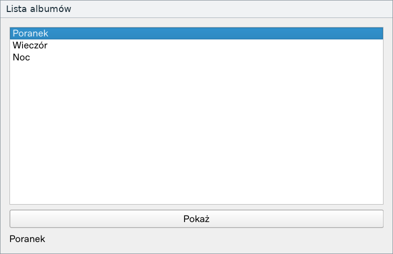
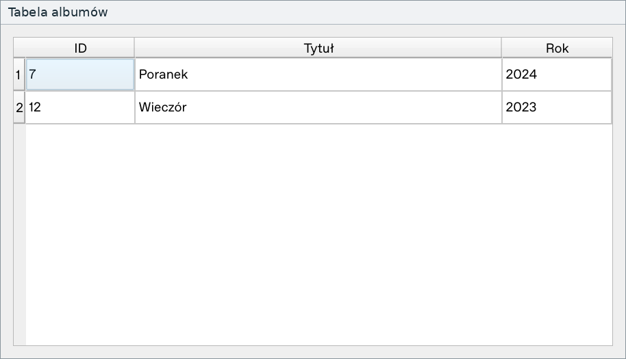
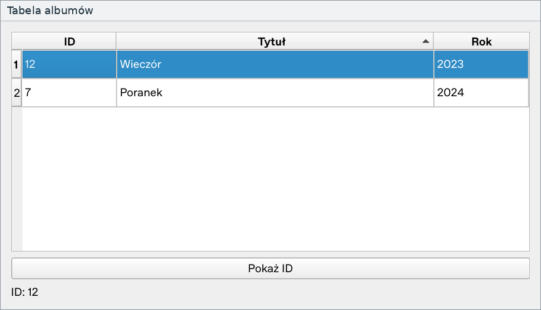
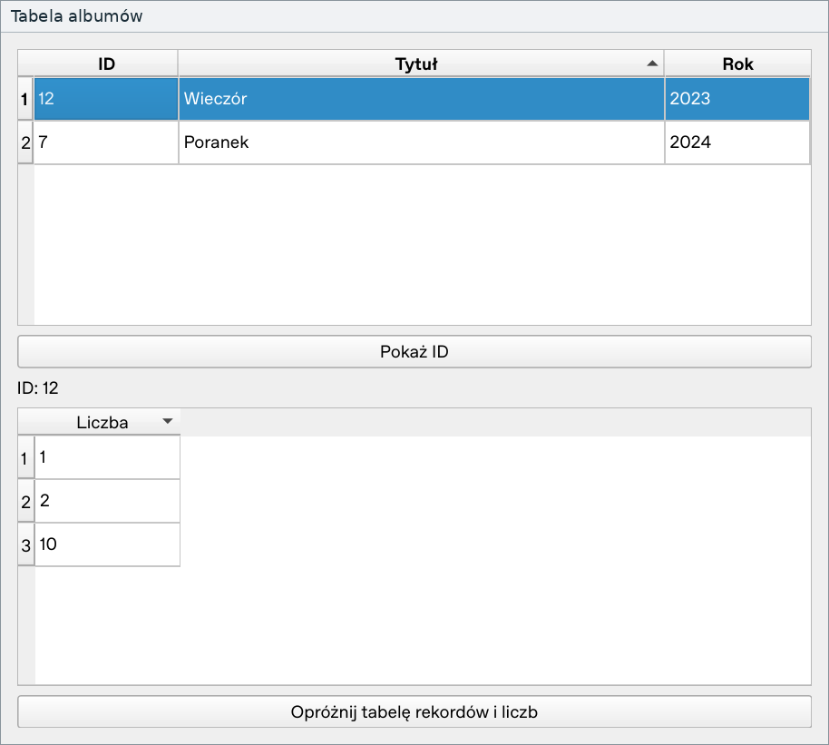

# Ćwiczenia: Wyświetlanie list i tabel z danymi w oknie aplikacji oraz zaznaczanie wierszy (QTableWidget)

**Temat 49 | Lekcje 97-98**

## Przygotowanie

W Qt Designer wybierz typ okna podany w zadaniu, ustaw `windowTitle` i odtwórz kontrolki z podglądu. Ustaw ich `objectName` według tabeli, nałóż layout i sprawdź podgląd przy zmianie rozmiaru. Zapisz plik `.ui` obok skryptu, zgodnie z nazwą z polecenia. W Pythonie odczytaj formularz przez `uic.loadUi()`, a potem podłącz sygnały i dopisz działanie. Podgląd pokazuje przykład. Kolory systemowe, font i dokładna wielkość okna mogą się różnić.

Środowisko i polecenia uruchamiania opisano w [instrukcji głównej](../README.md#uruchamianie). Przed pracą zainstaluj zależności z dołączonego `requirements.txt` w wybranym środowisku: `py -m pip install -r requirements.txt`.

Utwórz pliki wskazane w zadaniach wewnątrz bieżącego folderu lekcji. Kod uruchamiaj w terminalu z tego folderu. Każde zadanie ma osobny starter. Zadania rozwijające aplikację wykonuj na kopii poprzedniego etapu, zgodnie z instrukcją startera.

## Reguły tabeli

Zadania zapisz w oddzielnych plikach. ID jest daną rekordu, nie indeksem wiersza. Odczytuj je z zaznaczonego wiersza albo przechowuj jako UserRole. Podczas wypełniania tabeli wyłącz sortowanie, a włącz je po uzupełnieniu wszystkich komórek. Brak zaznaczenia i pusta tabela muszą być obsłużone przed odczytem item(...). Sortowanie liczb wymaga wartości int w DisplayRole, a nie tekstu liczbowego.

## Sposób pracy podczas bloku

| Etap | Czas | Co robisz |
| --- | ---: | --- |
| Wyjaśnienia i demonstracja | 0-25 min | Czytasz przykład, przewidujesz wynik i zadajesz pytania. |
| Zadanie 1 z prowadzącym | 25-35 min | Uruchamiasz pierwszy wariant i objaśniasz kluczowy zapis. |
| Zadanie 2 wspólnie | 35-50 min | Proponujesz kolejne kroki, sam zapisujesz kod. |
| Zadanie 3 samodzielnie | 50-70 min | Realizujesz kontrakt i wykonujesz próby. |
| Zadanie 4 lub diagnoza błędu | 70-85 min | Sprawdzasz przypadki graniczne i poprawiasz program. |
| Zakończenie | 85-90 min | Zapisujesz kod, jeden wniosek i wykonane próby. |

Tempo ustala nauczyciel. Jeśli zadanie 4 jest większe, stanowi kontynuację na kolejnych zajęciach lub zastępuje dodatkową diagnozę. Zadania dodatkowe nie są warunkiem ukończenia podstawowego bloku.

**Podczas pracy:** korzystaj z [tabel składni i krótkich wzorców](KONSTRUKCJE.md). W [starterach](startery/README.md) znajdziesz punkty wyjścia. Pełne polecenia i nazwy docelowych plików są poniżej.

## Zadanie 1. Lista albumów

**Punkt wyjścia:** [starter zadania 1](startery/zadanie1.py).

**Widok wzorcowy.** Lista albumów zajmuje górną część. Poniżej przycisk „Pokaż” i miejsce na tytuł lub komunikat. Zrzut może pokazywać przykładowe dane po wykonaniu próby.

**Plik projektu** `zadanie1.ui`, typ `QWidget`, tytuł „Lista albumów”.

| Kontrolka | `objectName` |
| --- | --- |
| QListWidget | `lista` |
| QPushButton | `pokazButton` |
| QLabel | `wynik` |

- Dodaj QListWidget z tytułami „Poranek”, „Wieczór” i „Noc”.
- Po kliknięciu przycisku „Pokaż” wypisz bieżący tytuł w QLabel.
- Bez zaznaczenia pokaż „Wybierz album”.

**Wynik kontrolny:** wybrany tytuł albo czytelny komunikat.

## Zadanie 2. Tabela rekordów

**Punkt wyjścia:** [starter zadania 2](startery/zadanie2.py).

**Widok wzorcowy.** Główna tabela ma kolumny ID, Tytuł i Rok. Kliknięcie zaznacza jeden cały wiersz. Komórki są tylko do odczytu. Zrzut może pokazywać przykładowe dane po wykonaniu próby.

**Plik projektu** `zadanie2.ui`, typ `QWidget`, tytuł „Tabela albumów”.

| Kontrolka | `objectName` |
| --- | --- |
| QTableWidget | `tabela` |

- Utwórz kolumny ID, Tytuł, Rok i rekordy (7,Poranek,2024), (12,Wieczór,2023).
- Wypełnij wszystkie komórki i ustaw zaznaczanie pojedynczego wiersza.
- Zablokuj edycję komórek bezpośrednio w tabeli.

**Wynik kontrolny:** 2 wiersze i 3 czytelne kolumny.

## Zadanie 3. ID po sortowaniu

**Punkt wyjścia:** [starter zadania 3](startery/zadanie3.py).

**Widok wzorcowy.** Główna tabela ma kolumny ID, Tytuł i Rok. Kliknięcie zaznacza jeden cały wiersz. Komórki są tylko do odczytu. Pod tabelą „Pokaż ID” i etykieta wyniku. Zrzut może pokazywać przykładowe dane po wykonaniu próby.

**Plik projektu** `zadanie3.ui`, typ `QWidget`, tytuł „Tabela albumów”.

| Kontrolka | `objectName` |
| --- | --- |
| QTableWidget | `tabela` |
| QPushButton | `odczytButton` |
| QLabel | `wynik` |

- W tabeli zadania 2 włącz sortowanie po tytule.
- Przyciskiem „Pokaż ID” odczytaj ID aktualnie wybranego rekordu.
- Sprawdź oba rekordy przed sortowaniem i po odwróceniu kierunku.

**Wynik kontrolny:** Poranek ma zawsze ID 7, Wieczór zawsze ID 12.

## Zadanie 4. Dla chętnych: Liczby i pusta tabela

**Punkt wyjścia:** [starter zadania 4](startery/zadanie4.py).

**Widok wzorcowy.** Główna tabela ma kolumny ID, Tytuł i Rok. Kliknięcie zaznacza jeden cały wiersz. Komórki są tylko do odczytu. Pod tabelą „Pokaż ID” i etykieta wyniku. Dalej osobna tabela z kolumną „Liczba” oraz przycisk opróżniania. Zrzut może pokazywać przykładowe dane po wykonaniu próby.

**Plik projektu** `zadanie4.ui`, typ `QWidget`, tytuł „Tabela albumów”.

| Kontrolka | `objectName` |
| --- | --- |
| QTableWidget | `tabela` |
| QPushButton | `odczytButton` |
| QLabel | `wynik` |
| QTableWidget | `liczby` |
| QPushButton | `oproznijButton` |

- Dodaj tabelę z kolumną Liczba i wartościami 2, 10, 1 jako DisplayRole typu int.
- Włącz sortowanie rosnące. Następnie ustaw liczbę wierszy na 0.
- Sprawdź obsługę przycisku odczytu, gdy tabela jest pusta.

**Wynik kontrolny:** kolejność 1,2,10. Po opróżnieniu: komunikat, bez wyjątku.

## Diagnoza i praca domowa

Otwórz [zadanie naprawcze](diagnoza/README.md). Ma własny kontrakt i celowo błędny kod. Wykonaj je na zajęciach lub dokończ w domu zgodnie z ustaleniem prowadzącego.

## Oddanie pracy

Dołącz własny plik `.ui` do kodu zadania okienkowego, jeśli był używany.

Zachowaj źródła i niezbędne pliki danych. W `testy.md` opisz rzeczywiście wykonane próby: dane, oczekiwany wynik, wynik otrzymany i wniosek. Własną instrukcję uruchomienia zapisz w `URUCHOMIENIE.md`, aby zachować treść zadań w tym README. Dołącz dokumentację wskazaną w poleceniu. Zadania oznaczone jako dodatkowe są dla chętnych.

[Spis lekcji](../README.md)

## Utrwalanie Git w ramach tego bloku

Przed zmianą sprawdź `git status`, a po działającej poprawce obejrzyj `git diff`. Zapisz mały commit z opisem wykonanej zmiany. Czynność zajmuje 2–3 minuty przewidziane na sprawdzenie pracy.
