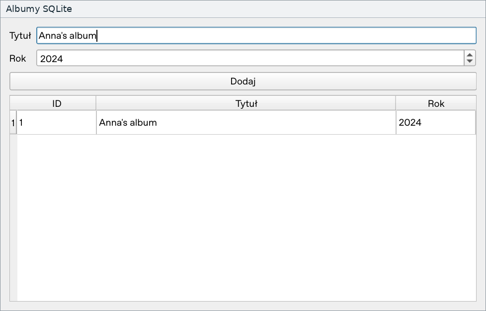
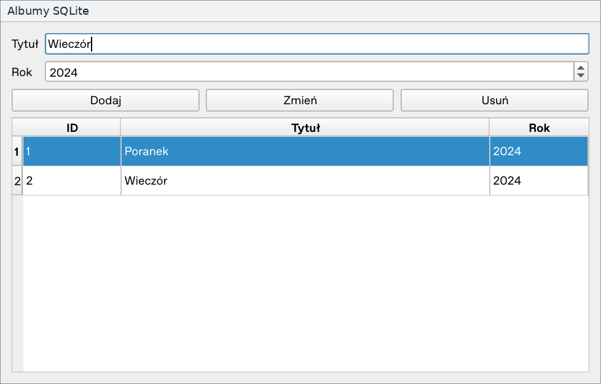

# Ćwiczenia: Zapisywanie i odczytywanie danych z lokalnej bazy danych SQLite w aplikacji okienkowej (sqlite3)

**Temat 50 | Lekcje 99-100**

## Przygotowanie

W Qt Designer wybierz typ okna podany w zadaniu, ustaw `windowTitle` i odtwórz kontrolki z podglądu. Ustaw ich `objectName` według tabeli, nałóż layout i sprawdź podgląd przy zmianie rozmiaru. Zapisz plik `.ui` obok skryptu, zgodnie z nazwą z polecenia. W Pythonie odczytaj formularz przez `uic.loadUi()`, a potem podłącz sygnały i dopisz działanie. Podgląd pokazuje przykład. Kolory systemowe, font i dokładna wielkość okna mogą się różnić.

Środowisko i polecenia uruchamiania opisano w [instrukcji głównej](../README.md#uruchamianie). Przed pracą zainstaluj zależności z dołączonego `requirements.txt` w wybranym środowisku: `py -m pip install -r requirements.txt`.

Utwórz pliki wskazane w zadaniach wewnątrz bieżącego folderu lekcji. Kod uruchamiaj w terminalu z tego folderu. Każde zadanie ma osobny starter. Zadania rozwijające aplikację wykonuj na kopii poprzedniego etapu, zgodnie z instrukcją startera.

## Schemat bazy i podział kodu

Przygotuj `baza.py` dla operacji SQL i osobny plik Pythona dla każdego zadania. Zadanie 1 zapisuje dane do `albumy.db`. W zadaniach 2 i 3 skopiuj [starter modułu bazy](startery/baza.py) obok skryptu okna. Skrypty ustawiają odpowiednio `zadanie2.db` i `zadanie3.db`. Każdy etap ma własne dane. Tabela `albumy`: `id INTEGER PRIMARY KEY`, `tytul TEXT NOT NULL`, `rok INTEGER NOT NULL CHECK(rok BETWEEN 1900 AND 2100)`. Tytuł po strip nie może być pusty. Używaj parametrów `?`, zatwierdzaj transakcje i zamykaj połączenia. Inicjalizacja tabeli ma być idempotentna. Dane początkowe dodawaj jednorazowo, nie przy każdym odczycie.

Próbę wycofania wykonaj w oddzielnej pustej bazie testowej, np. `:memory:`; przygotowanie tabeli zatwierdź przed transakcją z dwoma INSERT. Nie testuj błędnych transakcji na własnych danych użytkowych.

## Sposób pracy podczas bloku

| Etap | Czas | Co robisz |
| --- | ---: | --- |
| Wyjaśnienia i demonstracja | 0-25 min | Czytasz przykład, przewidujesz wynik i zadajesz pytania. |
| Zadanie 1 z prowadzącym | 25-35 min | Uruchamiasz pierwszy wariant i objaśniasz kluczowy zapis. |
| Zadanie 2 wspólnie | 35-50 min | Proponujesz kolejne kroki, sam zapisujesz kod. |
| Zadanie 3 samodzielnie | 50-70 min | Realizujesz kontrakt i wykonujesz próby. |
| Zadanie 4 lub diagnoza błędu | 70-85 min | Sprawdzasz przypadki graniczne i poprawiasz program. |
| Zakończenie | 85-90 min | Zapisujesz kod, jeden wniosek i wykonane próby. |

Tempo ustala nauczyciel. Jeśli zadanie 4 jest większe, stanowi kontynuację na kolejnych zajęciach lub zastępuje dodatkową diagnozę. Zadania dodatkowe nie są warunkiem ukończenia podstawowego bloku.

**Podczas pracy:** korzystaj z [tabel składni i krótkich wzorców](KONSTRUKCJE.md). W [starterach](startery/README.md) znajdziesz punkty wyjścia. Pełne polecenia i nazwy docelowych plików są poniżej.

## Zadanie 1. Utwórz i odczytaj bazę

**Punkt wyjścia:** [starter zadania 1](startery/zadanie1.py).

- Utwórz nową albumy.db z tabelą opisaną powyżej.
- Dodaj parametrami dwa albumy: (Poranek,2024), (Wieczór,2023).
- Wypisz id, tytuł i rok, uporządkowane po id. Uruchom osobno sam odczyt.

**Wynik kontrolny:** Po pierwszym uruchomieniu są dwa rekordy. Uruchom skrypt drugi raz w tym samym folderze. Liczba rekordów i ich ID powinny pozostać takie same.

## Zadanie 2. Formularz dodawania

**Punkt wyjścia:** [starter zadania 2](startery/zadanie2.py).

**Widok wzorcowy.** U góry formularz z polami „Tytuł” i „Rok” (1900–2100, domyślnie 2024). Niżej przycisk „Dodaj”, a pod nim tabela ID, Tytuł, Rok. Zrzut może pokazywać przykładowe dane po wykonaniu próby.

**Plik projektu** `zadanie2.ui`, typ `QWidget`, tytuł „Albumy SQLite”.

| Kontrolka | `objectName` |
| --- | --- |
| QLineEdit | `tytul` |
| QSpinBox | `rok` |
| QPushButton | `dodajButton` |
| QTableWidget | `tabela` |

- Zbuduj QLineEdit tytułu, QSpinBox 1900-2100 i przycisk „Dodaj”.
- Po poprawnym zapisie odśwież QTableWidget. Odrzuć pusty tytuł.
- Dodaj tytuł „Anna's album”, aby sprawdzić przekazanie apostrofu jako danych.

**Wynik kontrolny:** apostrof zapisany poprawnie, pusty tytuł nie tworzy rekordu.

## Zadanie 3. Zmiana i usunięcie po ID

**Punkt wyjścia:** [starter zadania 3](startery/zadanie3.py).

**Widok wzorcowy.** U góry formularz z polami „Tytuł” i „Rok” (1900–2100, domyślnie 2024). Niżej przycisk „Dodaj”, a pod nim tabela ID, Tytuł, Rok. W wierszu przycisków są też „Zmień” i „Usuń”. Wybiera się jeden pełny wiersz. Zrzut może pokazywać przykładowe dane po wykonaniu próby.

**Plik projektu** `zadanie3.ui`, typ `QWidget`, tytuł „Albumy SQLite”.

| Kontrolka | `objectName` |
| --- | --- |
| QLineEdit | `tytul` |
| QSpinBox | `rok` |
| QPushButton | `dodajButton` |
| QPushButton | `zmienButton` |
| QPushButton | `usunButton` |
| QTableWidget | `tabela` |

- Dodaj obsługę zaznaczonego rekordu: zmień jego tytuł, potem usuń go.
- Wykonuj SQL po id, nie po numerze wiersza ani po tytule.
- Sprawdź próbę operacji bez zaznaczenia i po sortowaniu tabeli.

**Wynik kontrolny:** zmienia się tylko wskazany rekord, brak wyboru daje komunikat.

## Zadanie 4. Dla chętnych: Wycofanie transakcji

**Punkt wyjścia:** [starter zadania 4](startery/zadanie4.py).

- W nowej testowej bazie wykonaj w jednym with db dwa INSERT.
- Pierwszy: (Dobry,2024). Drugi: (Błędny,1800), naruszający CHECK.
- Przechwyć IntegrityError poza with db i odczytaj tabelę.

**Wynik kontrolny:** tabela pusta. Cała transakcja została wycofana.

## Diagnoza i praca domowa

Otwórz [zadanie naprawcze](diagnoza/README.md). Ma własny kontrakt i celowo błędny kod. Wykonaj je na zajęciach lub dokończ w domu zgodnie z ustaleniem prowadzącego.

## Oddanie pracy

Dołącz własny plik `.ui` do kodu zadania okienkowego, jeśli był używany.

Zachowaj źródła i niezbędne pliki danych. W `testy.md` opisz rzeczywiście wykonane próby: dane, oczekiwany wynik, wynik otrzymany i wniosek. Własną instrukcję uruchomienia zapisz w `URUCHOMIENIE.md`, aby zachować treść zadań w tym README. Dołącz dokumentację wskazaną w poleceniu. Zadania oznaczone jako dodatkowe są dla chętnych.

[Spis lekcji](../README.md)

## Utrwalanie Git w ramach tego bloku

Przed zmianą sprawdź `git status`, a po działającej poprawce obejrzyj `git diff`. Zapisz mały commit z opisem wykonanej zmiany. Czynność zajmuje 2–3 minuty przewidziane na sprawdzenie pracy.
